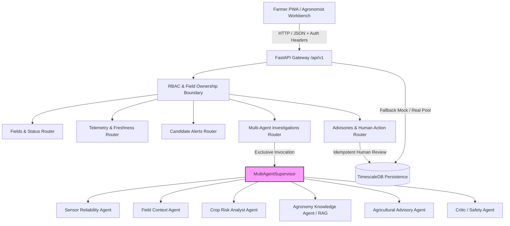

# AgriKafka-Agent Backend API Contracts & Interface Specification

**Document Version:** 1.0.0  
**Status:** Approved & Verified  
**Applicable Stages:** Stage 17 (Backend API), Stage 18 (Farmer PWA), Operations & Observability  
**Related Architecture Decisions:** `ADR-0007` (FastAPI + Asyncpg/Psycopg), `ADR-0010` (Multi-Agent State Machine Supervisor)

---

## 1. Overview & Architectural Boundaries

The AgriKafka-Agent Backend API exposes a versioned REST interface (`/api/v1`) providing operational visibility, field profile management, real-time sensor observations, deterministic risk alerts, multi-agent investigations, and human-in-the-loop advisory approval.



### Multi-Agent Interaction Invariants
1. **No Direct Agent Invocation:** The API communicates exclusively with `MultiAgentSupervisor`. No endpoint directly accesses or calls `sensor_reliability_agent`, `crop_risk_analyst`, `knowledge_agent`, `advisory_agent`, or `critic_agent`.
2. **State Transition Integrity:** The API cannot advance state machine states without genuine supervisor execution. Client requests cannot skip revision cycles or override critic verdicts.
3. **No Information Leakage:** Responses omit internal chain-of-thought, private system prompts, vector embeddings, infrastructure credentials, or local filesystem paths. Responses expose sanitized summaries, accredited citations, and structured reason codes.
4. **Zero Physical Actuation Invariant:** Human decisions (`APPROVE`, `REJECT`) update advisory statuses (`APPROVED_BY_HUMAN`, `REJECTED_BY_HUMAN`) and log audit records. Under no circumstances do API endpoints dispatch physical hardware actuation or automated valve commands.

---

## 2. Authentication & Authorization Headers

All endpoints authenticate requests through standard HTTP request headers:

| Header Name | Type | Description | Default |
| :--- | :--- | :--- | :--- |
| `X-User-Role` | String | User role: `farmer`, `agronomist`, or `admin`. | `farmer` |
| `X-User-ID` | String | Unique caller ID (e.g., `farmer-kolar-01`). | Derived from role |
| `X-Farmer-ID` | String | Designated farmer parcel identifier (e.g., `field-kolar-001`). Used to enforce field parcel ownership boundaries. | Configured default |
| `X-API-Key` | String | Secret key required for operations debug routes. Matches `AGRI_ADMIN_API_KEY`. | None |
| `X-Request-ID` | String | Optional client request correlation token echoed in responses. | Auto-generated UUID |

### RBAC Access Matrix

| Category / Route | Farmer | Agronomist | Administrator |
| :--- | :--- | :--- | :--- |
| Public Liveness (`/healthz`, `/readyz`, `/metrics`) | Permitted | Permitted | Permitted |
| Own Field Parcels (`/api/v1/fields/{own_id}`) | Read / Status | Read / Write | Read / Write |
| Foreign Field Parcels (`/api/v1/fields/{other_id}`) | **Denied (403)** | Read / Write | Read / Write |
| Trigger Investigation (`POST /api/v1/investigations`) | Own field only | All fields | All fields |
| Review Investigation Timeline & Messages | Own field only | All fields | All fields |
| Human Decision / Advisory Action (`POST .../action`) | **Denied (403)** | Permitted | Permitted |
| Submit Farmer Execution Feedback | Permitted | Permitted | Permitted |
| System Operations Status (`/api/v1/operations/status`) | **Denied (403)** | Permitted | Permitted |
| Admin Debug State (`/api/v1/admin/debug/state`) | **Denied (403)** | **Denied (403)** | Permitted (with API Key) |

---

## 3. Standard Response & Error Envelope

All error responses adhere to a consistent RFC 7807-compatible error model:

```json
{
  "error_code": "HTTP_403",
  "message": "Access denied: User 'farmer-kolar' with role 'farmer' is not authorized to access field parcel 'field-demo-parcel'.",
  "details": null,
  "request_id": "req-9c87d4a2-1e9a-41d1"
}
```

Standard HTTP status codes utilized:
- `200 OK` — Successful query or operation.
- `201 Created` — Resource successfully created or registered.
- `400 Bad Request` — Schema validation failure or invalid action string.
- `401 Unauthorized` — Missing credentials where authentication is mandatory.
- `403 Forbidden` — Role privilege or field parcel ownership violation.
- `404 Not Found` — Resource identifier does not exist.
- `409 Conflict` — State transition conflict (e.g., submitting human decision on a run that is not in `awaiting_human_review`).
- `422 Unprocessable Entity` — Pydantic payload parsing error.
- `500 Internal Server Error` — Unhandled server exception with redacted diagnostics.

---

## 4. Endpoints Specification

### 4.1 System Operations & Health

#### `GET /healthz`
- **Summary:** Service liveness probe.
- **Access:** Unrestricted.
- **Response `200 OK`:**
```json
{
  "service": "agri-api",
  "status": "HEALTHY",
  "version": "1.0.0",
  "environment": "development",
  "uptime_seconds": 1245.8,
  "components": {
    "api_server": {
      "status": "UP",
      "latency_ms": 0.1,
      "message": "FastAPI ASGI running"
    }
  }
}
```

#### `GET /readyz`
- **Summary:** Service readiness probe (validates database pool and vector store availability).
- **Access:** Unrestricted.
- **Response `200 OK`:**
```json
{
  "service": "agri-api",
  "status": "HEALTHY",
  "version": "1.0.0",
  "environment": "development",
  "uptime_seconds": 1245.8,
  "components": {
    "database": {
      "status": "UP",
      "latency_ms": 0.8,
      "message": "Connected to TimescaleDB"
    },
    "vector_store": {
      "status": "UP",
      "latency_ms": 1.2,
      "message": "Chroma persistence available"
    }
  }
}
```

#### `GET /metrics`
- **Summary:** Standard Prometheus metrics scrape endpoint.
- **Access:** Unrestricted.
- **Response `200 OK`:** `text/plain; version=0.0.4`.

#### `GET /api/v1/operations/status`
- **Summary:** Operations telemetry overview.
- **Access:** Agronomist or Administrator role.
- **Response `200 OK`:**
```json
{
  "status": "OPERATIONAL",
  "active_investigations_count": 1,
  "completed_investigations_count": 14,
  "abstained_investigations_count": 2,
  "kafka_broker_status": "HEALTHY (KRaft Mode)",
  "timescaledb_status": "ACTIVE (PersistenceRepository)",
  "chromadb_vector_store_status": "ONLINE (21 chunks, v1.0-1b95cf635c01)",
  "total_metrics_scraped": 32
}
```

---

### 4.2 Farm & Field Parcel Management

#### `GET /api/v1/fields`
- **Summary:** List registered farm parcels (paginated).
- **Parameters:** `is_active` (boolean, optional), `limit` (int, default 20), `offset` (int, default 0).
- **Response `200 OK`:** `PaginatedResponse[FieldProfileResponse]`.

#### `POST /api/v1/fields`
- **Summary:** Register a new agricultural field parcel.
- **Access:** Agronomist or Administrator.
- **Request Body:** `FieldProfileCreate`.
- **Response `201 Created`:** `ActionStatusResponse`.

#### `GET /api/v1/fields/{id}`
- **Summary:** Retrieve field parcel profile and soil properties.
- **Response `200 OK`:**
```json
{
  "field_id": "field-kolar-001",
  "name": "Kolar North Parcel - Finger Millet Demonstration",
  "latitude": 13.1333,
  "longitude": 78.1333,
  "elevation_m": 822.0,
  "crop_name": "finger_millet",
  "variety": "GPU-28",
  "sowing_date": "2026-07-15",
  "expected_harvest_date": "2026-11-20",
  "current_growth_stage": "flowering",
  "soil_type": "red_sandy_loam",
  "soil_texture": "sandy_clay_loam",
  "field_capacity": 0.22,
  "wilting_point": 0.10,
  "root_zone_depth_m": 0.50,
  "irrigation_type": "rainfed",
  "is_active": true,
  "metadata": {"zone": "Karnataka Zone 5", "taluk": "Kolar"}
}
```

#### `PATCH /api/v1/fields/{id}` & `PUT /api/v1/fields/{id}`
- **Summary:** Update field metadata (growth stage, irrigation type, crop variety).
- **Access:** Field owner, Agronomist, or Admin.
- **Response `200 OK`:** `ActionStatusResponse`.

#### `GET /api/v1/fields/{id}/status`
- **Summary:** Real-time operational status, composite stress index, and data freshness.
- **Response `200 OK`:**
```json
{
  "field_id": "field-kolar-001",
  "crop_variety": "GPU-28",
  "growth_stage": "flowering",
  "composite_stress_index": 0.76,
  "risk_level": "HIGH",
  "sensor_health_overall": "HEALTHY",
  "latest_soil_moisture": 0.12,
  "latest_ambient_temp": 31.8,
  "telemetry_latency_seconds": 18.4,
  "active_alerts_count": 1,
  "pending_advisories_count": 1,
  "data_freshness_status": "FRESH"
}
```

---

### 4.3 Telemetry & Sensor Health

#### `GET /api/v1/fields/{id}/observations`
- **Summary:** Historical physical sensor observations.
- **Parameters:** `variable` (string, optional), `hours` (int, default 24), `limit` (int, default 50).
- **Response `200 OK`:** `PaginatedResponse[ObservationResponse]`.

#### `GET /api/v1/fields/{id}/trends`
- **Summary:** 24-hour statistical metrics and trend slopes.
- **Response `200 OK`:**
```json
{
  "field_id": "field-kolar-001",
  "window_hours": 24,
  "soil_moisture_trend": "DEPLETING",
  "soil_moisture_mean": 0.13,
  "soil_moisture_min": 0.11,
  "soil_moisture_max": 0.16,
  "ambient_temp_mean": 29.4,
  "ambient_temp_max": 33.1,
  "relative_humidity_mean": 58.2,
  "observation_count": 96
}
```

#### `GET /api/v1/sensors/freshness`
- **Summary:** Telemetry ingestion freshness and latency across sensor nodes.
- **Response `200 OK`:** `List[SensorFreshnessResponse]`.

---

### 4.4 Alerts & Multi-Agent Investigations

#### `GET /api/v1/alerts`
- **Summary:** Query candidate agricultural risk alerts.
- **Parameters:** `field_id` (optional), `status` (optional), `severity` (optional), `limit` (default 20).
- **Response `200 OK`:** `PaginatedResponse[CandidateAlertResponse]`.

#### `POST /api/v1/investigations`
- **Summary:** Trigger multi-agent investigation on a candidate alert.
- **Access:** Field owner, Agronomist, or Admin.
- **Request Body:**
```json
{
  "alert_id": "c1a4169f-48bd-494d-a2e0-32c3f2e9688a",
  "field_id": "field-kolar-001",
  "priority": "HIGH",
  "notes": "Triggered field verification"
}
```
- **Response `201 Created`:**
```json
{
  "run_id": "run-62a01e39-8e9c-4fb5-97fd-f4df4a5399b0",
  "alert_id": "c1a4169f-48bd-494d-a2e0-32c3f2e9688a",
  "field_id": "field-kolar-001",
  "current_state": "awaiting_human_review",
  "final_decision": "AWAITING_HUMAN_REVIEW",
  "revision_count": 0,
  "max_revisions": 2,
  "abstention_reason": null,
  "summary_title": "Apply 25mm Protective Irrigation to Prevent Yield Loss",
  "reliability_assessment": {
    "is_trustworthy": true,
    "health_state": "HEALTHY",
    "reason_code": "ALL_SENSORS_VALID",
    "summary": "Soil probe and weather station telemetry verified healthy."
  },
  "risk_assessment": {
    "severity": "HIGH",
    "category": "SOIL_MOISTURE_DEPLETION",
    "deterministic_csi": 0.76,
    "hypothesis": "Root-zone soil moisture has fallen below critical FAO-56 depletion threshold p=0.65."
  },
  "advisory_preview": {
    "title": "Apply 25mm Protective Irrigation to Prevent Yield Loss",
    "category": "IRRIGATION",
    "urgency": "HIGH",
    "confidence": 0.92,
    "citations": ["CIT-FAO56-001", "CIT-ICAR-RAGI-001"],
    "next_step": "Submit for human agronomist review before farmer dispatch."
  },
  "critic_verdict": "APPROVED_FOR_HUMAN_REVIEW",
  "safety_gate_passed": true,
  "created_at": "2026-11-04T12:05:00Z",
  "updated_at": "2026-11-04T12:05:04Z"
}
```

#### `GET /api/v1/investigations/{id}/timeline`
- **Summary:** State machine transition timeline.
- **Response `200 OK`:** `List[StateTimelineEvent]`.

#### `GET /api/v1/investigations/{id}/messages`
- **Summary:** Sanitized agent handoff summaries (auditable; omits private prompts and secrets).
- **Response `200 OK`:** `List[AgentHandoffSummary]`.

#### `GET /api/v1/investigations/{id}/citations`
- **Summary:** Accredited evidence chunks from RAG knowledge base.
- **Response `200 OK`:** `List[CitationReferenceResponse]`.

#### `POST /api/v1/investigations/{id}/human-decision`
- **Summary:** Submit human approval or rejection on an investigation awaiting review.
- **Access:** Agronomist or Administrator.
- **Request Body:**
```json
{
  "action": "APPROVE",
  "reviewer_id": "agronomist-kvk-kolar",
  "comments": "Confirmed severe dry spell against regional rainfall deficit.",
  "idempotency_key": "idem-token-7788"
}
```
- **Response `200 OK`:**
```json
{
  "success": true,
  "recommendation_id": "rec-62a01e39-8e9c",
  "resulting_status": "approved_by_human",
  "action_taken": "APPROVE",
  "approved_by": "agronomist-kvk-kolar",
  "timestamp": "2026-11-04T12:10:00Z",
  "message": "Human decision 'APPROVE' successfully recorded. Zero autonomous actuation was dispatched."
}
```

---

### 4.5 Advisories & Farmer Feedback

#### `GET /api/v1/advisories`
- **Summary:** List proposed or resolved farmer advisories (paginated).
- **Response `200 OK`:** `PaginatedResponse[AdvisoryResponse]`.

#### `POST /api/v1/advisories/{id}/action`
- **Summary:** Submit agronomist or supervisor decision on an advisory (`APPROVE`, `REJECT`, `REQUEST_INSPECTION`, `ACKNOWLEDGE`, `EXPIRE`, `SUPERSEDE`).
- **Access:** Agronomist or Administrator.
- **Request Body:**
```json
{
  "action": "APPROVE",
  "reviewer_id": "agronomist-kvk-kolar",
  "advisory_version": 1,
  "comments": "Confirmed severe dry spell against regional rainfall deficit.",
  "idempotency_key": "idem-token-7788"
}
```
- **Response `200 OK`:** `HumanDecisionResponse` asserting `actuation_command_dispatched: false`.
- **Response `409 Conflict`:** Stale advisory version or attempting conflicting action on an already finalized (`APPROVED` / `REJECTED`) recommendation.

#### `GET /api/v1/feedback`
- **Summary:** List farmer outcome feedback records with multi-agent investigation linkage.
- **Response `200 OK`:** `PaginatedResponse[HumanFeedbackResponse]`.

#### `POST /api/v1/feedback`
- **Summary:** Submit structured farmer feedback linked to advisory and multi-agent investigation.
- **Access:** Field owner, Agronomist, or Admin.
- **Request Body:**
```json
{
  "recommendation_id": "rec-62a01e39-8e9c",
  "field_id": "field-kolar-001",
  "investigation_id": "4b62e49c-882e-4ccb-a367-27bfe142994a",
  "alert_id": "c1a4169f-48bd-494d-a2e0-32c3f2e9688a",
  "advisory_version": 1,
  "rating": 5,
  "action_taken": true,
  "observed_outcome": "Soil moisture restored to 0.20 m3/m3 within 12 hours.",
  "advisory_relevant": true,
  "evidence_useful": true,
  "field_context_correct": true,
  "sensor_issue_reported": false,
  "sensor_issue_notes": null,
  "expert_followup_requested": false,
  "cited_agent_outputs": ["sensor_reliability_agent:out_01", "agronomy_knowledge_agent:out_02"],
  "feedback_comments": "Applied protective irrigation as advised. Crop stress mitigated.",
  "idempotency_key": "fb-idem-9988"
}
```
- **Response `201 Created`:** `HumanFeedbackResponse`.
- **Hard Invariant:** Feedback is logged for offline Stage 20 evaluation. Zero online mutation of agent system instructions or agronomic thresholds.

---

### 4.6 Notifications & Delivery Tracking

#### `GET /api/v1/notifications/dispatches`
- **Summary:** Query notification delivery logs, retry attempts, and Dead-Letter Queue (DLQ) volume.
- **Access:** Agronomist or Administrator.
- **Parameters:** `recipient_id` (string, optional), `status` (string, optional: `PENDING`, `SENT`, `FAILED`, `DEAD_LETTER`), `limit` (int, default 20), `offset` (int, default 0).
- **Response `200 OK`:** `PaginatedResponse[NotificationDispatchResponse]`.


