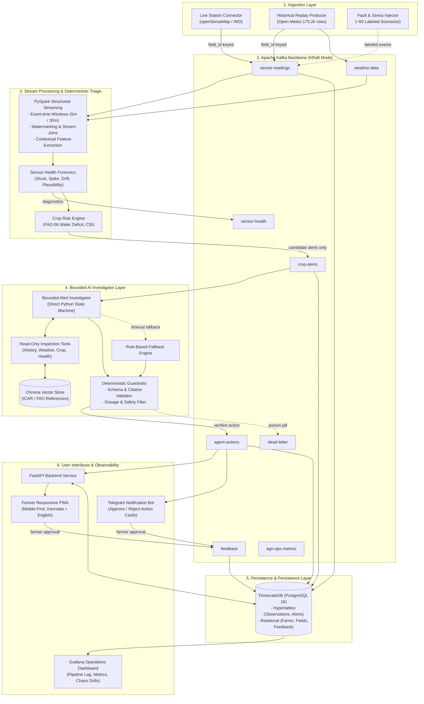

# AgriKafka-Agent — System Architecture Specification (v1.0.0)

**Document Version:** 1.0.0  
**Status:** Baseline Architecture Proposal (Pending User Approval)  
**Date:** 2026-11-01  
**Project:** AgriKafka-Agent: Fault-Tolerant, Real-Time Agricultural Risk Monitoring and Decision Support  

---

## 1. System Overview & Component Boundaries

AgriKafka-Agent combines high-throughput event streaming, windowed PySpark stream processing, deterministic sensor-health and crop-risk algorithms, and a bounded AI investigator agent with human-in-the-loop validation.

---

## 2. Topic Topology & Partitioning Strategy

All topics are partitioned by `field_id` to guarantee that observations for any given field are strictly ordered within a single partition:

| Topic Name | Partition Key | Purpose | Producer | Consumer(s) |
|---|---|---|---|---|
| `sensor-readings` | `field_id` | Raw and replayed environmental sensor readings | Ingestion Services | PySpark Stream Processor, TimescaleDB Sink |
| `weather-data` | `field_id` | Ambient meteorological context (rain, wind, forecast) | Weather Connector | PySpark Stream Processor |
| `sensor-health` | `field_id` | Diagnostic health flags (`HEALTHY`, `STUCK`, `DRIFT`) | Health Forensics Service | Alert Investigator, TimescaleDB Sink |
| `crop-alerts` | `field_id` | Filtered candidate alerts exceeding stress baselines | Risk Engine | Alert Investigator Consumer Group |
| `agent-actions` | `field_id` | Validated triage classifications and advisory action cards | Alert Investigator | FastAPI, Telegram Bot, TimescaleDB Sink |
| `feedback` | `field_id` | Farmer approval/rejection decisions | Telegram Bot, Farmer PWA | TimescaleDB Sink, Pipeline Metrics |
| `dead-letter` | `field_id` | Quarantined malformed or poison-pill events | All Services | Engineering Inspection |
| `agri-ops-metrics` | `service_name`| Operational metrics (lag, micro-batch latency, token cost)| Prometheus Exporters | Grafana Dashboard |

---

## 3. Dual Runtime Profiles: `dev` vs `resilience`

To satisfy both low-overhead local development on a laptop and multi-broker academic failure demonstrations, the system is designed with two distinct Docker Compose profiles:

### A. Development Profile (`dev`)
- **Target File:** `docker-compose.dev.yml`
- **Purpose:** Daily feature development, API building, PWA UI testing, and prompt engineering with minimal RAM usage.
- **Components:**
  - 1 Apache Kafka Broker (KRaft mode, port `9092`).
  - 1 TimescaleDB instance (PostgreSQL 16, port `5432`).
  - In-process embedded Chroma vector store (local disk).
  - FastAPI backend (`localhost:8000`).
  - Vite PWA dev server (`localhost:5173`).
- **Resource Footprint:** $\approx 1.8\text{ GB RAM}$ total.

### B. Resilience Profile (`resilience`)
- **Target File:** `docker-compose.yml`
- **Purpose:** Formal course evaluation, chaos engineering drills, and multi-broker failover demonstrations.
- **Components:**
  - 3 Apache Kafka Brokers (KRaft cluster: `kafka-1:9092`, `kafka-2:9093`, `kafka-3:9094`).
  - 1 PySpark Streaming container (`bitnami/spark:3.5.3`).
  - 1 TimescaleDB instance.
  - 1 Prometheus container (`localhost:9090`).
  - 1 Grafana container (`localhost:3000`).
  - Agent and Ingestion worker containers.
- **Resource Footprint:** $\approx 4.8\text{ GB RAM}$ total (compatible with the host's 15.4 GB total RAM).

---

## 4. Network Exposure & Security Boundary
- **Localhost Binding:** Every exposed host port (`9092`, `5432`, `8000`, `3000`, `9090`, `5173`) binds exclusively to `127.0.0.1`.
- **Zero Public Ingress:** No service is exposed to the public internet (`0.0.0.0`).
- **Credentials:** All services read credentials from `.env` via environment variables. Zero credentials are committed to version control.
