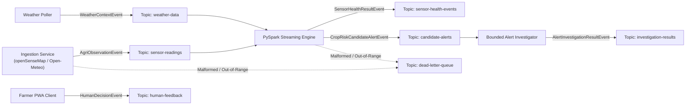

# AgriKafka-Agent — Canonical Event Contracts & Schema Governance

**Project:** AgriKafka-Agent: Fault-Tolerant, Real-Time Agricultural Risk Monitoring and Decision Support  
**Stage:** Stage 7 — Canonical Event Contracts Implementation  
**Package:** `packages/event-contracts/`  
**Governing Rules:** [.agents/rules/agri-event-contracts](file:///c:/Users/prana/OneDrive/Desktop/spa_pbl/agri_streaming_project/.agents/skills/agri-event-contracts/SKILL.md) & [.agents/rules/data-provenance.md](file:///c:/Users/prana/OneDrive/Desktop/spa_pbl/agri_streaming_project/.agents/rules/data-provenance.md)  
**Status:** Approved & Formally Verified  

---

## 1. Overview & Architectural Role

All inter-service communication across AgriKafka-Agent's Kafka event backbone is governed by strict Pydantic v2 schemas defined in `packages/event-contracts/`. In accordance with [ADR-0003](file:///c:/Users/prana/OneDrive/Desktop/spa_pbl/agri_streaming_project/docs/decisions/ADR-0003-event-serialization-schema-governance.md), event contracts enforce dual-boundary validation (producer serialization and consumer deserialization) without running a heavyweight Schema Registry container.



---

## 2. Event Taxonomy & Core Models

| Event Contract Name | Primary Kafka Topic | Role & Producing Service | Key Identifier Fields |
|---|---|---|---|
| `AgriObservationEvent` | `sensor-readings`, `validated-observations` | Atomic physical, external station, or replayed observation | `event_id`, `field_id`, `sensor_id`, `variable` |
| `WeatherContextEvent` | `weather-data` | External gridded weather observation or forecast horizon | `event_id`, `field_id`, `forecast_horizon_hours` |
| `SensorHealthResultEvent` | `sensor-health-events` | Forensic sensor health diagnosis (stuck, spike, drift, etc.) | `event_id`, `field_id`, `sensor_id`, `health_flag` |
| `CropRiskCandidateAlertEvent`| `candidate-alerts` | Deterministic numerical risk calculation (moisture deficit, heat, CSI) | `alert_id`, `field_id`, `crop_name`, `risk_level` |
| `AlertInvestigationResultEvent`| `investigation-results` | Bounded LLM investigation, citations, Kannada advisory, approval token | `alert_id`, `field_id`, `decision`, `approval_token` |
| `HumanDecisionEvent` | `human-feedback` | Farmer or agronomist authorization / override from Farmer PWA | `alert_id`, `approval_token`, `operator_id`, `decision` |
| `DeadLetterRecordEvent` | `dead-letter-queue` | Forensic wrapper for corrupted, unparseable, or out-of-range payloads | `dlq_id`, `failed_topic`, `error_class`, `raw_payload` |

---

## 3. Data Provenance & Source Isolation

In strict accordance with [.agents/rules/data-provenance.md](file:///c:/Users/prana/OneDrive/Desktop/spa_pbl/agri_streaming_project/.agents/rules/data-provenance.md), every event carries a mandatory `provenance` envelope:

```python
class ProvenanceMetadata(BaseModel):
    provenance_class: ProvenanceClass  # Exactly one of the 7 allowed classes
    dataset_origin: str                # e.g. "openSenseMap-Station-Sarvamangalam", "Open-Meteo-ERA5"
    is_synthetic: bool                 # True for simulations/fault drills
    scenario_id: str | None = None     # Drill ID if injected
    source_uri: str | None = None      # Upstream API endpoint or dataset URI
    raw_payload_hash: str | None = None # Upstream SHA-256 for auditability
```

### The 7 Allowed Provenance Classes
1. `physical_sensor`: Authentic hardware sensor located directly on a farm parcel or validated station.
2. `external_station`: Remote public meteorological station (e.g., openSenseMap node miles away).
3. `modelled_reanalysis`: Gridded mathematical model estimate (e.g., Open-Meteo ERA5-Land topsoil moisture).
4. `forecast`: Numerical weather prediction outlook (1–7 days).
5. `derived`: Algorithmic calculations (e.g. Penman-Monteith ET0, CSI, leaf wetness proxy).
6. `historical_replay`: Replayed historical records from the 2-year Karnataka dataset.
7. `injected_scenario`: Controlled synthetic drills (heatwave stress, sensor flatline).

> [!CAUTION]
> **Prohibition Against Conflating Modelled and Physical Telemetry:**
> Open-Meteo's `soil_moisture_0_to_7cm` is an algorithmic reanalysis model output. It must **never** be labeled `physical_sensor` nor carry a fabricated `sensor_id`. Physical soil moisture remains strictly on the historical replay path and authenticated Edge Gateway Mock.

---

## 4. Standardized Units & Plausible Agronomic Ranges

All observation values must be finite (no `NaN`, `Inf`, `-Inf`) and strictly conform to standardized SI units:

| Observed Variable | Canonical Standard Unit | Plausible Range | Handling for Out-of-Range Values |
|---|---|---|---|
| `temperature_2m` | `celsius` | `[-5.0, 55.0]` | Tagged `OUT_OF_RANGE`; routed to DLQ if physical impossibility |
| `relative_humidity_2m` | `percent` | `[0.0, 100.0]` | Capped/Flagged `OUT_OF_RANGE` |
| `dew_point_2m` | `celsius` | `[-10.0, 40.0]`| Tagged `OUT_OF_RANGE` |
| `precipitation` | `mm` | `[0.0, 300.0]` | Hourly accumulation |
| `precipitation_rate` | `mm_per_hour` | `[0.0, 300.0]` | Instantaneous intensity |
| `vapour_pressure_deficit` | `kpa` | `[0.0, 10.0]` | Atmospheric evaporative demand |
| `soil_moisture_0_to_7cm` | `m3_per_m3` | `[0.0, 0.70]` | Volumetric water content (m³/m³) |
| `soil_moisture_15cm` | `m3_per_m3` | `[0.0, 0.70]` | Shallow root-zone probe |
| `soil_moisture_30cm` | `m3_per_m3` | `[0.0, 0.70]` | Deep root-zone probe |
| `wind_speed_10m` | `m_per_s` | `[0.0, 50.0]` | Converted automatically from km/h ($v / 3.6$) |
| `barometric_pressure` | `hpa` | `[800.0, 1100.0]`| Atmospheric pressure |
| `solar_radiation` | `w_per_m2` | `[0.0, 1500.0]` | Global solar irradiance |
| `crop_stress_index` | `fraction_0_to_1` | `[0.0, 1.0]` | Multi-factor index |

---

## 5. Representative Contract JSON Examples

All 10 representative JSON examples are verified by unit tests in `tests/contract/test_event_contracts.py` and located under `packages/event-contracts/examples/`.

### Example 1: Physical Sensor Observation (Stage 6 Verified openSenseMap Station)
File: [packages/event-contracts/examples/physical_sensor_opensensemap_sarvamangalam.json](file:///c:/Users/prana/OneDrive/Desktop/spa_pbl/agri_streaming_project/packages/event-contracts/examples/physical_sensor_opensensemap_sarvamangalam.json)
```json
{
  "event_id": "7f8b9a1e-3c2d-4e5f-a6b7-8c9d0e1f2a3b",
  "schema_version": "1.0.0",
  "event_time": "2026-11-01T14:43:14Z",
  "ingestion_time": "2026-11-01T14:43:15Z",
  "field_id": "KA_KOLAR_EXTERNAL_01",
  "idempotency_key": "osm_689b2bdc569c2d0007586ae9_temp_1730472194",
  "source_provider": "openSenseMap",
  "sensor_id": "689b2bdc569c2d0007586aea",
  "station_id": "689b2bdc569c2d0007586ae9",
  "variable": "temperature_2m",
  "value": 25.39,
  "unit": "celsius",
  "location": {
    "latitude": 11.995079,
    "longitude": 79.804492,
    "elevation_m": 42.0
  },
  "provenance": {
    "provenance_class": "physical_sensor",
    "dataset_origin": "openSenseMap-Station-Sarvamangalam",
    "is_synthetic": false
  }
}
```

### Example 2: Historical Reanalysis Soil Moisture (Explicitly Modelled)
File: [packages/event-contracts/examples/historical_reanalysis_soil_moisture.json](file:///c:/Users/prana/OneDrive/Desktop/spa_pbl/agri_streaming_project/packages/event-contracts/examples/historical_reanalysis_soil_moisture.json)
```json
{
  "event_id": "4d5e6f7a-8b9c-4d1e-2f3a-5b6c7d8e9f0a",
  "schema_version": "1.0.0",
  "event_time": "2025-07-15T10:00:00Z",
  "ingestion_time": "2026-11-01T20:00:00Z",
  "field_id": "KA_KOLAR_RAGI_01",
  "idempotency_key": "open_meteo_era5_kolar_soil_2025071510",
  "source_provider": "open_meteo_archive",
  "sensor_id": null,
  "variable": "soil_moisture_0_to_7cm",
  "value": 0.243,
  "unit": "m3_per_m3",
  "location": {
    "latitude": 13.13,
    "longitude": 78.13,
    "elevation_m": 822.0
  },
  "provenance": {
    "provenance_class": "modelled_reanalysis",
    "dataset_origin": "Open-Meteo-ERA5-Land-Reanalysis",
    "is_synthetic": false
  }
}
```

---

## 6. Schema Evolution & Compatibility Policy

The AgriKafka-Agent event contracts follow strict **Semantic Versioning (SemVer)** rules:
1. **Backwards Compatibility:** All consumer services (PySpark streaming jobs, risk engine, alert investigator) must successfully parse records produced under older schemas within the same major version (`1.x.x`).
2. **Non-Breaking Evolution:**
   - Any new field added to an existing event contract must be optional and provide an explicit default value (e.g. `None` or `False`).
   - Fields must never be deleted or renamed within a major version.
   - Enum additions (e.g. a new `ObservedVariable`) must be handled gracefully by consumers with an `UNKNOWN` fallback.
3. **Dual-Boundary Validation:**
   - Producers validate output payloads prior to calling `producer.produce()`.
   - Consumers validate input payloads immediately upon calling `consumer.poll()`.
   - Deserialization failures trigger `wrap_in_dead_letter(...)` and are forwarded to topic `dead-letter-queue` without stopping consumer lag or freezing the pipeline.
