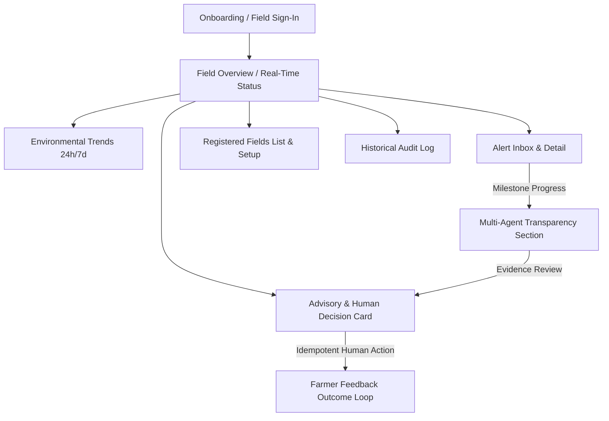

# AgriKafka-Agent Farmer PWA Specification & Workflow Documentation

**Module:** `apps/farmer-pwa`  
**Version:** 1.0.0  
**Status:** Implemented & Verified (Stage 18)  
**Target User Persona:** Smallholder Dryland Farmers (Kolar / Karnataka Zone 5) & Extension Agronomists  
**Related Documents:** `ADR-0007`, `docs/architecture/API_CONTRACTS.md`, `docs/architecture/MULTI_AGENT_ARCHITECTURE.md`

---

## 1. Design Principles & Agricultural Grounding

1. **Farmer-Centric Simplicity:**
   - Technical infrastructure details (Kafka topics, Spark batch IDs, consumer lag, z-scores, internal embeddings, LLM prompts) are strictly concealed from normal farmer screens.
   - All environmental variables are displayed with clear physical units ($m^3/m^3$, $^\circ\text{C}$, $\%$, $\text{mm}$) and contextual interpretations (e.g., "Below FAO-56 Threshold (0.166 m³/m³)" rather than raw standard deviations).
2. **Transparent Multi-Agent Investigation:**
   - Alert details feature an embedded milestone progress section reflecting real state machine transitions.
   - Distinct milestones:
     1. Checking Measurement Reliability (`sensor_reliability_agent`)
     2. Reviewing Field & Soil Context (`field_context_agent`)
     3. Analysing Candidate Agronomic Risk (`crop_risk_analyst`)
     4. Checking Agronomic References (`agronomy_knowledge_agent`)
     5. Reviewing Advisory for Safety (`critic_safety_agent`)
   - Prominently states that agents assist investigations with accredited scientific citations (FAO-56, ICAR-CRIDA, UAS Bangalore) and do not replace local agronomist judgment.
3. **Zero Autonomous Actuation:**
   - The PWA enforces the core safety invariant: all recommendations require human review (`APPROVE`, `REJECT`, `REQUEST_INSPECTION`).
   - Human decisions record approval provenance and outcome feedback without triggering physical hardware pump commands.
4. **Bilingual Localisation:**
   - Full support for English and Kannada (ಕನ್ನಡ) with instantaneous in-app language switching.
   - Key botanical and hydrological terminology is translated into standard Kannada dialect for Zone 5 farmers.

---

## 2. UI Route Inventory & Screen Workflows

The PWA is organized into a mobile-first, tabbed navigation architecture with persistent accessible header and bottom navigation bar:

### Screen Inventory

| Screen # | Screen Component | Route / View ID | Target User Capability |
| :--- | :--- | :--- | :--- |
| **1** | `OnboardingScreen` | Initial Launch | Farmer onboarding, persona selection (Farmer vs Agronomist), field parcel selection, and bilingual language toggle. |
| **2** | `FieldsScreen` (List) | `fields` | View all registered agricultural parcels, crop types, growth stages, soil types, and active statuses. |
| **3** | `FieldsScreen` (Modal) | `fields/setup` | Register new parcel or update existing metadata (variety, sowing date, growth stage, soil type, irrigation method). |
| **4** | `OverviewScreen` | `overview` | Real-time conditions: soil moisture ($m^3/m^3$), air temperature ($^\circ\text{C}$), humidity ($\%$), CSI stress index ($\%$), and telemetry provenance tags. |
| **5** | `TrendsScreen` | `trends` | 24-hour and 7-day environmental trends with hourly dry-down bars and FAO-56 depletion threshold comparison. |
| **6** | `SensorHealthNotice` | `overview` (embedded) | Plain-language sensor reliability notice explaining ground probe health vs telemetry delays. |
| **7** | `AlertsScreen` | `alerts` | Risk alerts inbox: what was observed, event timestamp, severity level, physical evidence breakdown, and crop impact explanation. |
| **8** | `AdvisoriesScreen` | `advisories` | Validated agronomic recommendations: proposed next step, evidence citations, assumptions, limitations, and confidence score. |
| **9** | `AdvisoriesScreen` (Action) | `advisories/action` | One-tap human review controls (`Approve`, `Reject`, `Request Inspection`) sending idempotent decision tokens to backend API. |
| **10** | `HistoryScreen` | `history` | Chronological audit trail of past alerts, multi-agent evaluations, human review decisions, and farmer feedback outcomes. |

---

## 3. Provenance & Uncertainty Rules

To prevent farmer confusion and ensure scientific rigor:
- **Ground Sensor vs Model Disambiguation:**
  - Readings derived from physical capacitive probes VH400 are tagged with `🏷️ Ground Soil Probe`.
  - Regional meteorological observations from openSenseMap are tagged with `🏷️ Regional Weather Station`.
  - Reanalysis / satellite estimates are tagged with `🏷️ Satellite / Model`.
- **Uncertainty & Risk Representation:**
  - Stress is expressed as a Crop Stress Index percentage with qualitative risk levels (`NORMAL`, `LOW`, `MEDIUM`, `HIGH`, `CRITICAL`).
  - Depletion is compared directly to the critical allowable depletion threshold $p = 0.65$ ($0.166 \text{ m}^3/\text{m}^3$ in Alfisols).
  - Explicit disclaimer: *"Notice: Automated agents assist field investigations with scientific citations. They do not replace local agricultural expert judgement."*

---

## 4. Accessibility & Mobile Compliance

- **WCAG 2.1 AA Standards:**
  - Color contrast ratios exceed 4.5:1 across text and background pairings.
  - Interactive touch targets maintain a minimum dimension of $44 \times 44\text{px}$ (navbar tabs are $48\text{px}$ minimum height).
  - Semantic HTML5 landmarks utilized throughout (`header[role="banner"]`, `nav[role="navigation"]`, `main`, `section`, `dialog[role="dialog"]`).
  - Explicit `aria-labels` and `aria-selected` attributes on interactive tabs and toggles.
  - Visible keyboard focus rings (`outline: 3px solid #16a34a`).
- **PWA & Offline Performance:**
  - `manifest.json` configured with theme color `#166534`, standalone display mode, and icon manifests.
  - `sw.js` precaches app shell and provides seamless offline fallback with cached data and an offline badge.
  - Production bundle size is optimized to **214 kB raw (63.95 kB gzipped)** for low-bandwidth cellular field environments.

