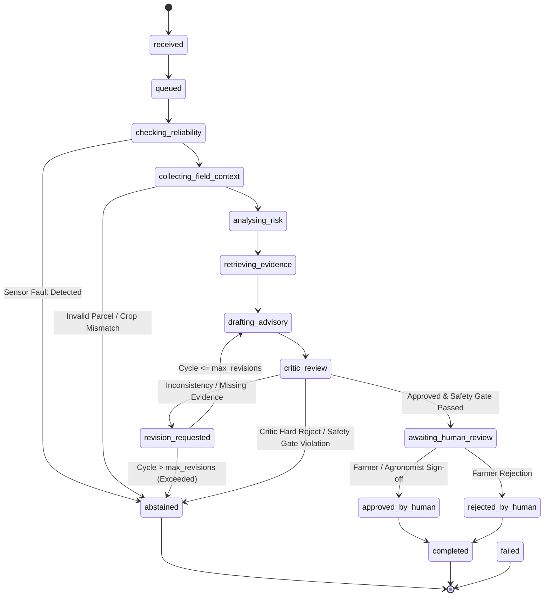

# Investigation State Machine Specification

- **Module:** `services/alert-investigator` (`src/agri_investigator/state.py`)
- **Status:** IMPLEMENTED AND VERIFIED
- **Date:** 2026-11-04
- **Author:** AgriKafka Engineering Team

---

## 1. Explicit Workflow States (15 States)

The investigation life cycle operates across 15 strongly typed states:



### State Catalog

| State Name | Semantic Scope | Terminal? | Permitted Transition Targets |
|---|---|---|---|
| `received` | Initial ingestion of candidate alert by Supervisor. | No | `queued`, `failed` |
| `queued` | Alert allocated an investigation `run_id` and prepared for fan-out. | No | `checking_reliability`, `collecting_field_context`, `failed` |
| `checking_reliability` | Dispatching and evaluating `sensor_reliability_agent`. | No | `collecting_field_context`, `analysing_risk`, `abstained`, `failed` |
| `collecting_field_context` | Dispatching and evaluating `field_context_agent`. | No | `checking_reliability`, `analysing_risk`, `abstained`, `failed` |
| `analysing_risk` | Evaluating deterministic CSI, hypothesis, and evidence requests. | No | `retrieving_evidence`, `abstained`, `failed` |
| `retrieving_evidence` | Querying Stage 15 RAG service via `agronomy_knowledge_agent`. | No | `drafting_advisory`, `revision_requested`, `abstained`, `failed` |
| `drafting_advisory` | Synthesizing grounded advisory proposal via `agricultural_advisory_agent`. | No | `critic_review`, `revision_requested`, `abstained`, `failed` |
| `critic_review` | Auditing consistency and citations via `critic_safety_agent`. | No | `awaiting_human_review`, `revision_requested`, `abstained`, `failed` |
| `revision_requested` | Routing feedback to upstream agent when revision needed. | No | `retrieving_evidence`, `drafting_advisory`, `critic_review`, `abstained`, `failed` |
| `awaiting_human_review` | Validated proposal staged for agronomist/farmer review in PWA. | No | `approved_by_human`, `rejected_by_human`, `completed` |
| `approved_by_human` | Human operator has certified and approved recommendation. | No | `completed` |
| `rejected_by_human` | Human operator has dismissed or countermanded recommendation. | No | `completed` |
| `abstained` | Run safely halted due to sensor fault, evidence gap, or policy veto. | **Yes** | None |
| `failed` | Unhandled system exception or fatal pipeline error. | **Yes** | None |
| `completed` | Full workflow concluded following human decision. | **Yes** | None |

---

## 2. Transition Matrix Enforcement

The `transition_state()` function in `state.py` validates every proposed transition against the `VALID_TRANSITIONS` mapping.
- Attempting an illegal jump (e.g. `received` -> `awaiting_human_review` or `abstained` -> `completed`) immediately raises an **`InvalidStateTransitionError`**.
- Every transition appends an immutable transition record to `state.audit_trail`:
  ```python
  {
      "type": "state_transition",
      "from_state": "checking_reliability",
      "to_state": "abstained",
      "triggered_by": "supervisor",
      "reason": "SENSOR_FAULT_SUPPRESSION: STUCK_VALUE_DETECTED",
      "timestamp": "2026-11-04T19:17:11.123456+00:00"
  }
  ```
- Transitions are simultaneously persisted to the database table `investigation_state_transitions` when a persistence pool is attached.

