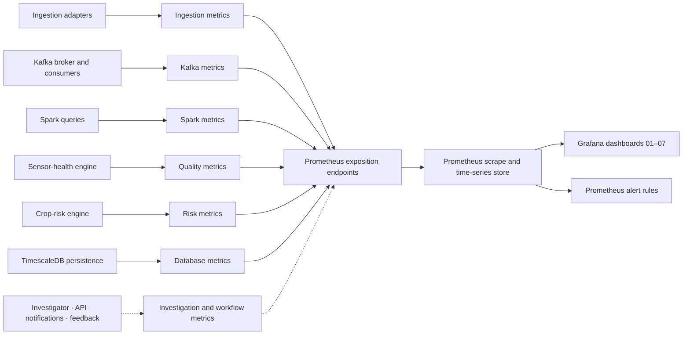

# AgriKafka-Agent Pipeline Workflow and Dashboard Map

This guide connects the intended agricultural data path to the seven Grafana dashboards. It also marks the boundary between code that exists and the full end-to-end service flow that remains to be integrated.

## 1. End-to-end workflow

The first diagram shows the decision-support flow. Solid arrows describe established data paths or implemented components; dashed arrows mark integrations or services that are planned or not launched by the root Docker Compose stack.

```mermaid
flowchart LR
  subgraph SOURCES[Data sources]
    OSM["openSenseMap<br/>physical station readings"]
    MET["Open-Meteo<br/>modelled weather context"]
    REPLAY["Historical CSV replay<br/>preserved observation times"]
    SCENARIO["Scenario injector<br/>labeled test events"]
  end

  ADAPTERS["Ingestion adapters<br/>normalize values and timestamps"]
  CONTRACT["Canonical event contracts<br/>UUIDv4 ID · UTC event time · units · provenance"]
  BROKER[(Kafka KRaft broker)]
  RAW[(agri.sensor-readings)]
  WEATHER[(agri.weather-data)]
  SPARK["Spark Structured Streaming<br/>parse · validate · range check<br/>10-minute event-time watermark<br/>idempotency-key deduplication"]
  VALID[(agri.validated-observations)]
  DLQ[(agri.dead-letter-queue)]
  HEALTH[Deterministic sensor-health forensics]
  HEALTH_TOPIC[(agri.sensor-health-events)]
  RISK["Deterministic crop-risk engine<br/>FAO-56 context · CSI · risk rules"]
  ALERT[(agri.candidate-alerts)]
  INVESTIGATOR["Bounded alert investigator<br/>grounded evidence and safety checks"]
  RESULT[(agri.investigation-results)]
  API[Backend API]
  PWA[Farmer PWA]
  FEEDBACK[(agri.human-feedback)]
  DB[("TimescaleDB<br/>time-series observations and audit data")]

  OSM --> ADAPTERS
  MET --> ADAPTERS
  REPLAY --> ADAPTERS
  SCENARIO --> ADAPTERS
  ADAPTERS --> CONTRACT --> BROKER
  BROKER --> RAW
  BROKER --> WEATHER
  RAW --> SPARK
  SPARK -->|valid and deduplicated| VALID
  SPARK -->|malformed or implausible| DLQ
  VALID -.-> HEALTH
  HEALTH -.-> HEALTH_TOPIC
  VALID -.-> RISK
  WEATHER -.->|context join planned| SPARK
  HEALTH -.->|usable sensor context| RISK
  RISK -.-> ALERT
  ALERT -.-> INVESTIGATOR
  INVESTIGATOR -.-> RESULT
  RESULT -.-> API
  API -.-> PWA
  PWA -.->|farmer accepts, rejects, or defers| FEEDBACK
  VALID -.-> DB
  HEALTH_TOPIC -.-> DB
  ALERT -.-> DB
  RESULT -.-> DB
  FEEDBACK -.-> DB
```

### Event path in plain language

1. **Collect observations.** Connectors read physical station data, modelled weather, historical records, or labeled test scenarios. Modelled weather and physical sensor values keep distinct provenance.
2. **Make events comparable.** Ingestion adapters normalize values, units, timestamps, field identity, and source metadata, then validate observations against the Pydantic event contracts.
3. **Buffer and distribute through Kafka.** Topics decouple producers from consumers. Records keyed by field support ordering within a field's partition and let consumers work independently.
4. **Validate the stream.** Spark reads `agri.sensor-readings`, parses the canonical shape, checks required fields, numeric values, units, and agronomic ranges, then separates valid records from DLQ records. Its event-time watermark bounds retained streaming state; idempotency-key plus event-time deduplication guards against repeated events.
5. **Assess field and sensor risk.** Deterministic sensor-health and crop-risk modules provide forensic classifications, safety gating, and candidate crop-risk calculations. These modules and Kafka topic contracts exist, but they are not all running together in the root Compose demo.
6. **Investigate and ask for human review.** The target architecture sends candidate alerts to a bounded, evidence-grounded investigator, then presents recommendations through the API/PWA. Farmer feedback closes the audit loop. The investigator, API, PWA, notifications, and feedback workflow remain planned stages.
7. **Persist and observe.** The persistence consumer is designed to store observations, health events, and alerts in TimescaleDB with idempotent writes. Prometheus collects operational metrics; Grafana turns them into dashboards and alert views.

## 2. What the current local demo launches

The root `docker-compose.yml` launches five services: Kafka, the Spark stream processor, TimescaleDB, Prometheus, and Grafana. Ingestion adapters run separately from the host CLI. In the prior bounded replay demonstration, five historical rows generated 35 observation events for Kafka.

The active Spark pipeline in `services/stream-processor/src/agri_stream_processor/pipeline.py` subscribes to `agri.sensor-readings` and starts two queries: one writes validated observations and the other writes DLQ records. The weather schema and topic are defined, but that pipeline does not currently subscribe to `agri.weather-data` or join weather into the sensor stream.

The deterministic health and risk engines and database consumer have implementation and test coverage, but the root Compose file does not launch those workers. The alert investigator, API, farmer PWA, and notification workflow are not implemented. Present these as architecture and project roadmap items unless you run and verify those specific services separately.

## 3. How metrics reach the dashboards

Prometheus metrics generally fall into three types:

- **Counter:** a value that only increases, such as records processed. Use `rate(counter[window])` for a per-second rate and `increase(counter[window])` for a count over a time window.
- **Gauge:** a value that can rise or fall, such as current broker reachability, sensor freshness, active connections, or CSI.
- **Histogram:** observations grouped into buckets, such as request or batch duration. `histogram_quantile` estimates p50 or p95 latency from those buckets.

Counters are process-lifetime totals. A large counter alone does not indicate current throughput or system quality; use an appropriate time window and check that the counter is incremented once per real event.

## 4. Dashboard-to-metric connections

| Dashboard | Main signals and metric families | Operational question it answers |
|---|---|---|
| **01 — System Overview** | Broker reachability (`agri_kafka_broker_reachable`); ingestion and Spark totals (`agri_ingestion_records_total`, `agri_spark_processed_rows_total`); candidate alerts (`agri_risk_candidate_alerts_total`); DLQ (`agri_kafka_dlq_messages_total`); throughput rates; scrape target `up`. | Is the broad pipeline reachable, moving records, and routing errors? Use this as the first overview, then open the dashboard for the stage that needs attention. |
| **02 — Kafka & Consumer Groups** | Per-topic production and consumption (`agri_kafka_messages_produced_total`, `agri_kafka_messages_consumed_total`); consumer backlog (`agri_kafka_consumer_lag_records`); DLQ counts by reason. | Are producers writing, consumers keeping up, and failures accumulating in a particular topic? Sustained rising lag suggests a consumer or downstream capacity problem. |
| **03 — Spark Streaming & Checkpoint Health** | Query input and processed row counters; micro-batch duration histogram; watermark timestamp; late-row drops; checkpoint commit counts and status. | Is Spark keeping pace? Are long-tail batches, late events, or failed checkpoint commits threatening progress or recovery? Watermark lag measures event-time progress, not CPU/runtime latency. |
| **04 — Ingestion & Source Freshness** | Observation freshness gauge; adapter status; external request-duration histogram; HTTP 429 counter; records by source type. | Is source data recent, is a connector active, is the provider slow or rate-limiting requests, and what type of data is entering the system? Keep physical, replayed, and modelled provenance clear. |
| **05 — Data Quality & Sensor Health** | Sensor-health evaluations by state and reason; active sensor state; natural-flatline exemptions; advisory safety-gate blocks. | Are sensors healthy, what anomaly explains a fault, and did safety rules suppress an advisory when evidence was unreliable? No data means no metric was reported for that view; it does not prove there were zero faults. |
| **06 — Candidate Alerts & Investigator** | CSI gauge (0–1); candidate alerts by severity and risk type; investigator tool calls; investigation latency histogram; fallback counter. | What crop stress score and candidate alerts exist, and can the investigator return a grounded result within its latency budget or fall back safely? Agent panels remain empty until that service is implemented and instrumented. |
| **07 — Reliability & Evaluation** | Database pool connection gauge; insert/dedup counters; analytical-query latency histogram; notification and deduplication counters; human feedback counts. | Is persistence healthy and idempotent, how long do queries take, and are delivery and farmer-response paths working? Empty workflow panels are expected while those services are not implemented. |

## 5. Reading the current Grafana screenshots accurately

The dashboard definitions show the intended metrics, but the current `infra/prometheus/metrics_exporter.py` includes demonstration values and polling-based counter increments. For example, it sets freshness to `14.2`, CSI to `0.18`, batch duration to `0.85`, and database connections to fixed values. It increments Kafka topic counters during metadata polls rather than reading actual producer/consumer offsets. The Grafana queries sum by topic or other labels, while `infra/prometheus/prometheus.yml` scrapes the same `host.docker.internal:8000` endpoint under five service job names. These choices can create inflated totals and duplicate rates.

Interpret the screenshots this way:

- **Kafka `HEALTHY`:** evidence that the exporter reached a broker during its Kafka metadata check. It does not establish multi-broker fault tolerance; the development profile has one broker.
- **Large totals and near-constant `0.5 msg/s` Kafka rate:** treat as exporter/demo behavior until counters are incremented from real event callbacks and duplicate scrape targets are removed.
- **Spark duration and watermark:** the displayed values mirror constants in the exporter, not measured Spark query progress. Use Spark `StreamingQueryProgress` data for real batch timing and watermark values.
- **14.2-second freshness and adapter `RUNNING`:** example values currently set by the exporter. Source adapters should publish their measured event-time-to-ingestion-time delta and lifecycle state.
- **Healthy sensor pie and `1.50k` anomaly bars:** not evidence of a real sensor-health benchmark. Instrument the deterministic evaluator for every observation and compare outputs with labeled fixtures.
- **CSI `0.180`:** a sample dimensionless score. It is not a validated score for each displayed field in this screenshot.
- **No data for investigator, API, notifications, or feedback:** consistent with services that are not implemented or instrumented yet.
- **Prometheus target table:** the five project job labels currently point at one metrics endpoint. `up=1` confirms that endpoint is scrapeable; it does not verify five separate services.

For a professor demonstration, show the metric definitions as the observability design, and use Kafka topic offsets, Spark query progress/logs, database rows, and service health checks as evidence for any measured result. State clearly which stages are running, which are tested as modules, and which remain planned.

## 6. Short professor talk track

> “The pipeline begins with physical station observations, modelled weather context, historical replay, or labeled test scenarios. Ingestion normalizes the records and attaches event time, field identity, units, and provenance before publishing canonical events to Kafka. Spark validates the sensor stream, applies event-time watermarking and deduplication, then sends valid records to the validated-observations topic and invalid records to the dead-letter queue. Deterministic sensor-health and crop-risk components provide the next decision layer. TimescaleDB is the persistence target, while Prometheus and Grafana are designed to show freshness, throughput, lag, processing latency, data quality, risk, and persistence health. In this local demonstration I verified Kafka, Spark's validation/DLQ queries, and a replay of 35 events. Some Grafana values are currently demo-exporter values, so I present them as monitoring design examples rather than measured performance. The investigator, API, farmer app, and notification path are future integration stages.”

## 7. Source of truth

- [System architecture](ARCHITECTURE_V1.md)
- [Kafka topic topology](KAFKA_TOPOLOGY.md)
- [Canonical event contracts](EVENT_CONTRACTS.md)
- [Prometheus metric definitions](../../packages/shared-python/src/agri_shared/metrics.py)
- [Prometheus scrape configuration](../../infra/prometheus/prometheus.yml)
- [Demonstration metrics exporter](../../infra/prometheus/metrics_exporter.py)
- [Grafana dashboard JSON files](../../infra/grafana/dashboards/)
- [Project implementation status](../development/STATUS_SNAPSHOT.md)
