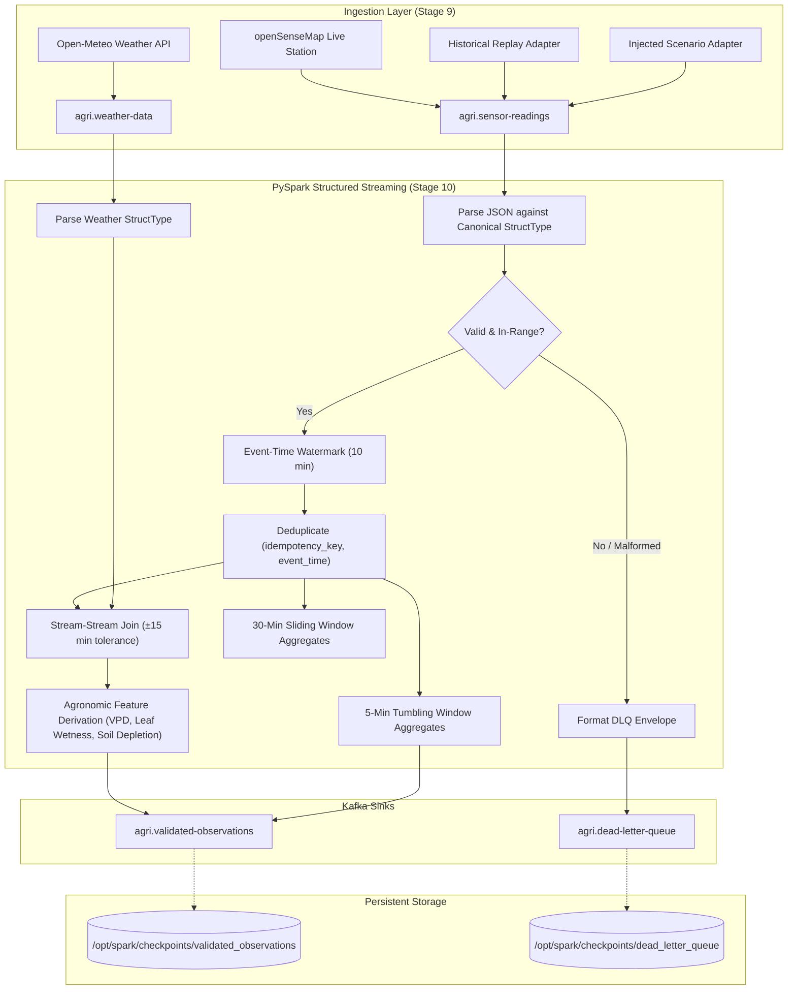

# AgriKafka-Agent: PySpark Structured Streaming Specification

**Stage:** Stage 10  
**Status:** Approved & Implemented  
**Package:** `services/stream-processor` (`agri_stream_processor`)  
**Runtime:** Apache Spark Structured Streaming 3.5.3, Python 3.11, OpenJDK 17 (per ADR-0001)

---

## 1. Executive Summary & Architectural Scope

The Stream Processing service represents the real-time computational core of the AgriKafka-Agent architecture. Positioned directly between the Ingestion Layer (`services/ingestion`) and the downstream Deterministic Health/Risk Evaluators (`services/health-service`, `services/risk-engine`), this service processes high-velocity IoT environmental observations and gridded weather forecasts.

---

## 2. Invariants & Guardrails

1. **Strictly No LLMs in the Streaming Loop:**  
   LLM calls incur variable latency ($1000\text{ms} - 8000\text{ms}$), rate limits, and non-deterministic failures. The streaming loop executes at sub-second micro-batch speeds purely evaluating deterministic filters, window statistics, and physical equations.
2. **Strict Data Provenance Isolation:**  
   Reanalysis and numerical weather context are strictly joined as contextual metadata (`weather_temp_c`, `modelled_sm_topsoil`). They **never** overwrite or masquerade as physical hardware telemetry (`value`, `sensor_id`).
3. **No Unbounded Memory State:**  
   Every stateful operation (deduplication, windowing, stream-stream join) has an explicit event-time watermark to ensure expired state rows are evicted from RocksDB/memory state stores.

---

## 3. Streaming Window & Watermark Policy

| Parameter | Value | Rationale |
|---|---|---|
| **Event-Time Watermark** | `10 minutes` | Allows cellular IoT telemetry buffering and network jitter over rural Karnataka 2G/4G towers while bounding memory state. |
| **Tumbling Window** | `5 minutes` | Matches standard agricultural sensor reporting frequencies (1–5 min) to compute rolling statistical summaries (mean, min, max, count, stddev). |
| **Sliding Window** | `30 minutes` (slide `5 minutes`) | Provides trend detection over longer horizons (e.g. rapid desiccation or prolonged leaf wetting). |
| **Stream-Stream Join Tolerance** | `±15 minutes` | Aligns hourly Open-Meteo model forecasts with discrete 5-minute sensor bursts without dropping unaligned timestamps. |
| **Micro-Batch Trigger Interval** | `5 seconds` | Balances pipeline responsiveness for acute frost/pest risks against JVM micro-batch coordination overhead. |

---

## 4. Derived Agronomic Feature Formulations

### 4.1 Vapor Pressure Deficit (VPD, in kPa)
Vapor Pressure Deficit reflects the drying power of the atmosphere on crop canopies:
$$e_s(T) = 0.61078 \times \exp\left(\frac{17.27 \times T}{T + 237.3}\right)$$
$$e_a(T, RH) = e_s(T) \times \left(\frac{RH}{100.0}\right)$$
$$VPD = \max(0.0, e_s - e_a)$$

### 4.2 Dew Point ($T_{\text{dew}}$, in °C)
Calculated via the Magnus-Tetens approximation:
$$\alpha(T, RH) = \frac{17.27 \times T}{237.3 + T} + \ln\left(\frac{\max(0.01, RH)}{100.0}\right)$$
$$T_{\text{dew}} = \frac{237.3 \times \alpha}{17.27 - \alpha}$$

### 4.3 Leaf Wetness Proxy (Dimensionless, $[0.0, 1.0]$)
A continuous physical proxy for blast fungus (*Magnaporthe grisea*) spore germination:
- If $RH < 80.0\%$, proxy $= 0.0$.
- If $RH \ge 80.0\%$, compute dew depression $\Delta T = \max(0.0, T - T_{\text{dew}})$.
- Proxy is graded:
  $$\text{proxy} = 0.6 \times \left(\frac{RH - 80}{20}\right) + 0.4 \times f(\Delta T)$$
  where $f(\Delta T) = 1.0$ for $\Delta T \le 0.5^\circ\text{C}$, tapering to $0.0$ at $\Delta T > 2.0^\circ\text{C}$.

### 4.4 Soil Moisture Depletion Rate ($\text{m}^3/\text{m}^3\text{ per hour}$)
$$\text{Rate} = \frac{\theta_{t-1} - \theta_t}{\Delta t_{\text{hours}}}$$
- Positive rate indicates soil drying (evapotranspiration and drainage).
- Negative rate indicates infiltration from rainfall or irrigation events.

---

## 5. Fault-Tolerance, Checkpoint Durability, and Delivery Semantics

### 5.1 Checkpoint Architecture
- **Location:** Dedicated named Docker volume `spark_checkpoints` mapped to `/opt/spark/checkpoints`.
- **Query Isolation:**
  - `/opt/spark/checkpoints/validated_observations`
  - `/opt/spark/checkpoints/dead_letter_queue`
- **Integrity Guarantee:** Checkpoints store committed Kafka offsets and metadata commits (`commits/`, `offsets/`, `sources/`, `state/`). On worker container restart or crash, Spark resumes processing from the exact committed offset, preventing uncommitted data loss.

### 5.2 Delivery Guarantees
- **Kafka Sink Delivery:** **At-least-once**. Because Kafka sinks in Spark Structured Streaming commit offsets upon completion of a batch, worker termination mid-batch results in re-execution of the uncommitted batch.
- **Deduplication Strategy:** Downstream consumers (TimescaleDB sink, Risk Engine) leverage the canonical `idempotency_key` (e.g. `field_id:sensor_id:timestamp`) for deterministic upsert / deduplication, converting at-least-once network delivery into effectively exactly-once business outcomes.

---

## 6. Verification & Test Evidence

| Test Suite | Scope | Result | Evidence |
|---|---|---|---|
| `tests/unit/test_stream_transformations.py` | Tetens VPD, Magnus dew point, leaf wetness proxy, soil depletion, schemas, validation boundaries | **15 / 15 Passed** | Automated pytest execution |
| `tests/integration/test_stream_pipeline.py` | Checkpoint paths, end-to-end transformation flow, poison pill routing | **3 / 3 Passed** | Automated pytest execution |
| `agri_stream_processor.app --mode dry-run` | CLI parsing, environment config audit, SparkSession builder | **Verified** | Clean exit code 0 |
| Entire Repository Test Suite | Contracts, ingestion, streaming unit & integration | **55 Passed, 1 Skipped** | Comprehensive pytest suite |

