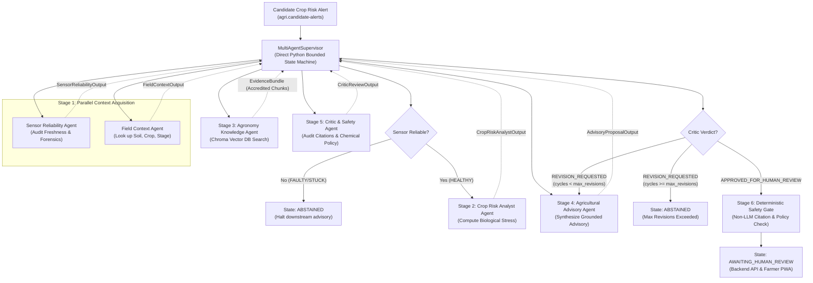

# AgriKafka-Agent: Multi-Agent Architecture & Coordination Specification

**Target Audience:** Professor Evaluation Panel (Agentic Artificial Intelligence)  
**Governing Architecture Decision:** `docs/decisions/ADR-0008-multi-agent-investigation-architecture.md`  
**Module Reference:** `services/alert-investigator` (`src/agri_investigator`)  

---

## 1. Why a Multi-Agent Architecture is Necessary for Agriculture

In agricultural IoT, single-agent architectures and monolithic LLM wrappers suffer from three fatal failure modes:
1. **Context Pollution:** Conflating hardware diagnostic logs, meteorological forecasts, soil physics, and chemical databases in a single prompt causes the model to lose track of safety boundaries.
2. **Unchecked Hallucinations:** A single LLM asked to simultaneously assess sensor health and recommend field actions will frequently hallucinate irrigation advice when readings are actually flatlined or corrupted.
3. **Auditability Deficits:** In high-stakes farming, agronomists require a clear audit trail distinguishing data trustworthiness from biological stress calculations and agronomic guidance.

Our multi-agent system enforces **Separation of Concerns**: each specialist agent is constrained to its specific domain with strict Pydantic input/output schemas.

---

## 2. Mermaid System Coordination Diagram

---

## 3. The Specialist Agents & Their Core Responsibilities

### 1. Sensor Reliability Agent (`SensorReliabilityAgent`)
- **Input:** Candidate alert, Stage 11 sensor-health classifications, observation quality flags, and provenance metadata.
- **Responsibility:** Assesses whether raw observations are trustworthy. Distinguishes genuine environmental changes from physical sensor fouling or network dropouts.
- **Constraint:** Can interpret health states but **must not override** authoritative deterministic classifications. If a sensor is `FAULTY` or `STUCK`, it immediately issues an abstention directive.

### 2. Field Context Agent (`FieldContextAgent`)
- **Input:** Target field parcel identifier (`field_id`).
- **Responsibility:** Retrieves static and phenological parcel metadata: soil taxonomy (Red Sandy Loam / *Alfisols*), root-zone depth ($0.5\,\text{m}$), field capacity ($0.22\,\text{m}^3/\text{m}^3$), wilting point ($0.10\,\text{m}^3/\text{m}^3$), crop variety (Ragi GPU-28), and days after sowing.

### 3. Crop Risk Analyst Agent (`CropRiskAnalystAgent`)
- **Input:** Combined outputs of `SensorReliabilityAgent` and `FieldContextAgent`.
- **Responsibility:** Calculates biological crop stress. Determines whether root-zone depletion has exceeded the critical FAO-56 threshold ($p=0.65$) for the current growth stage (Flowering / Grain Filling).

### 4. Agronomy Knowledge Agent (`AgronomyKnowledgeAgent`)
- **Input:** Biological risk hypothesis, crop name, growth stage, and soil type.
- **Responsibility:** Queries the Chroma persistent vector database. Retrieves accredited chunks from ICAR-CRIDA, UAS Bangalore, and FAO-56 literature. Returns verified citation IDs (`CIT-FAO56-001`, `UASB-POP-RAGI-2022:SEC03:CH01`).

### 5. Agricultural Advisory Agent (`AgriculturalAdvisoryAgent`)
- **Input:** Biological risk assessment and retrieved `EvidenceBundle`.
- **Responsibility:** Generates an actionable, accessible advisory card for the farmer. Synthesizes deficit protective irrigation guidance, lists critical assumptions, states limitations, and cites accredited sources.

### 6. Critic / Safety Agent (`CriticSafetyAgent`)
- **Input:** Proposed advisory, retrieved evidence bundle, and field context.
- **Responsibility:** Evaluates the advisory against safety rules. Verifies that all citations genuinely exist in the evidence bundle, checks that no forbidden chemical pesticides or uncalibrated dosages are recommended, and verifies uncertainty statements.
- **Action:** Issues `approved_for_human_review` or requests a structured revision with explicit feedback.

---

## 4. Key Architectural Questions & Technical Answers

### Q1: Why do we have a Supervisor instead of peer-to-peer agent communication?
**Answer:** In agricultural decision support, peer-to-peer agent messaging introduces non-deterministic execution paths, infinite message loops, and race conditions. Our `MultiAgentSupervisor` acts as a centralized coordinator maintaining a single authoritative `InvestigationState`. Every message routes through the supervisor, which validates state transitions against a formal transition graph, tracks iteration budgets, and logs an immutable audit trail to TimescaleDB.

### Q2: How is parallel execution implemented?
**Answer:** In Stage 1, the `SensorReliabilityAgent` and `FieldContextAgent` are independent—sensor verification does not depend on parcel soil type, and parcel lookup does not depend on real-time sensor health. The Supervisor dispatches both tasks concurrently and awaits both results before assembling the input for the `CropRiskAnalystAgent`.

### Q3: How does the Critic revision loop operate?
**Answer:** If the `CriticSafetyAgent` detects an issue (for example, missing limitations or vague irrigation timing), it issues a verdict of `revision_requested` accompanied by structured feedback instructions. The Supervisor increments `state.revision_count`. If `revision_count <= max_revisions` (default 2), it routes the instructions back to the `AgriculturalAdvisoryAgent`. If the limit is exceeded, it terminates the run with `ABSTAINED_MAX_REVISIONS_EXCEEDED` to prevent runaway API spend.

### Q4: Why are deterministic risk calculations kept separate from LLM agents?
**Answer:** Physical laws do not change based on prompt phrasing. Crop water balance, soil water depletion ($D_r$), and thermal degree hours are exact numerical equations codified in FAO-56. Calling an LLM to compute $(0.22 - 0.12) \times 500\,\text{mm}$ introduces floating-point hallucination risk. Our pipeline computes exact physical quantities deterministically; the AI agents are reserved for contextual interpretation, evidence retrieval, and linguistic synthesis.

### Q5: Why is the LLM not called for every observation?
**Answer:** Our ingestion stream processes observations every few seconds. Invoking an LLM for every raw observation would result in massive cost, untenable latency ($>1.5\,\text{s}$ per reading), and overwhelming alert fatigue. Only statistically significant anomalies and deterministic risk events published to `agri.candidate-alerts` initiate multi-agent investigation runs.

