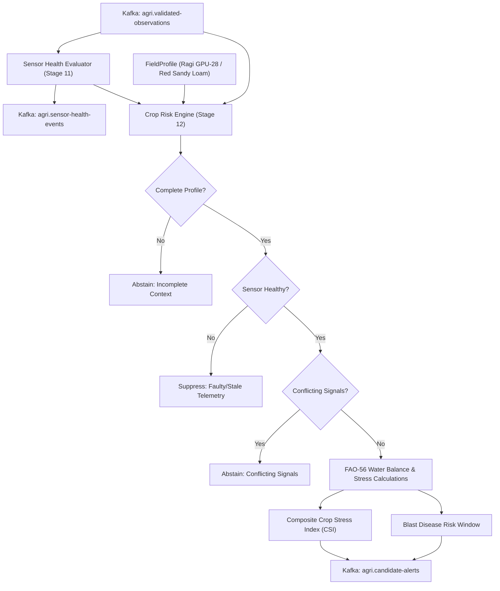

# AgriKafka Crop Risk Engine & Sensor Health Forensics

**Module:** `services/risk-engine`  
**Package:** `agri_risk_engine`  
**Implemented Stages:** Stage 11 (Sensor Health Forensics) & Stage 12 (Crop-Context-Aware Risk Engine)  
**Target Crop Focus:** Finger Millet (*Eleusine coracana*, Ragi) in Red Sandy Loam (Zone 5, Kolar, Karnataka)  
**Agronomic Grounding:** FAO-56, ICAR-IIMR, UAS Bangalore  

---

## 1. Overview & Architecture

The `services/risk-engine` package executes deterministic statistical anomaly detection, sensor health forensics, and contextual agronomic crop risk evaluation.



---

## 2. Directory Structure

```
services/risk-engine/
├── pyproject.toml              # UV workspace project definition
├── README.md                   # This documentation
└── src/
    └── agri_risk_engine/
        ├── __init__.py         # Package export
        ├── cli.py              # CLI for threshold audits and sample evaluation
        ├── health/             # Stage 11: Sensor Health Forensics Subsystem
        │   ├── detectors.py    # Temporal, electrical, boundary, variance detectors
        │   ├── evaluator.py    # Master DeterministicSensorHealthEvaluator
        │   ├── kafka_service.py# Streaming health tracker
        │   ├── state.py        # HealthState and reason codes
        │   └── thresholds.py   # Traceable threshold definitions
        └── risk/               # Stage 12: Crop-Context-Aware Risk Engine
            ├── detectors.py    # Rolling Z-score, EWMA, Isolation Forest
            ├── engine.py       # Master DeterministicCropRiskEngine
            ├── fao56.py        # FAO-56 TAW, RAW, depletion, CSI, blast window
            ├── field_profile.py# SoilProfile, CropStageParameters, FieldProfile
            └── kafka_service.py# Streaming candidate alert publisher
```

---

## 3. Verification & Testing

Execute the test suites across health and risk engines:
```bash
# Run sensor health tests
uv run pytest tests/unit/test_sensor_health_detectors.py
uv run pytest tests/unit/test_sensor_health_confusion_matrix.py -s

# Run crop risk engine unit & scenario tests
uv run pytest tests/unit/test_crop_risk_engine.py -v
uv run pytest tests/unit/test_crop_risk_scenarios.py -v
uv run pytest tests/integration/test_crop_risk_service.py -v

# Run entire repository suite (105 passed, 1 skipped)
uv run pytest
```
